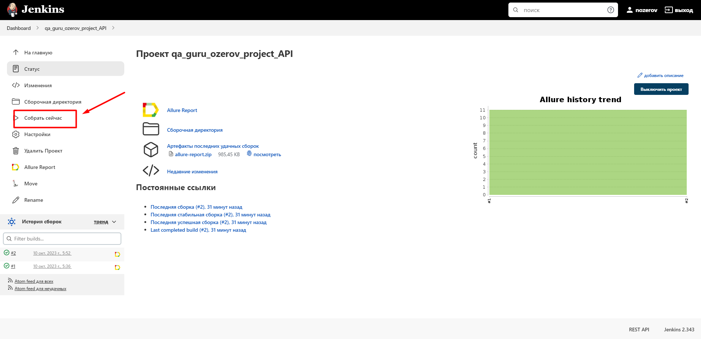
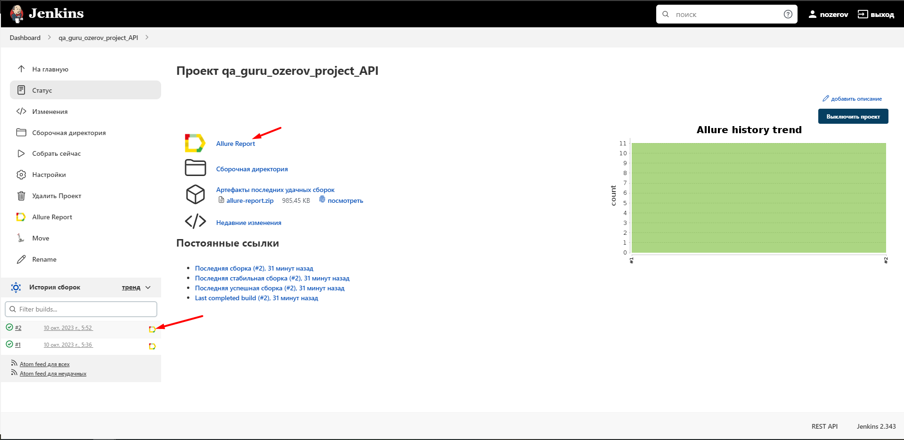
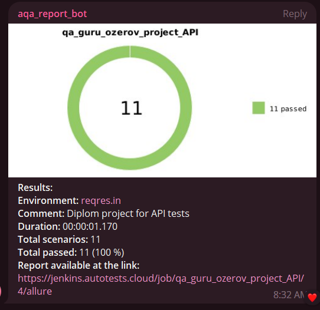

# API test automation project for the "reqres" demo service
> https://reqres.in/ — a sample application for practicing REST requests.

### Tech stack
<p  align="center">
  <code></code>
  <code></code>
  <code></code>
  <code></code>
  <code></code>
  <code></code>
</p>

## Test coverage
### reqres resource
- Create a user
- Update user data
- Successful registration of a new user
- Successful login
- Login with invalid credentials
- Users schema validation
- Get a page of users
- Get a single user
- Get a non-existent user
- Delete a user
- Registration with invalid data

## Running tests


### Local run
1. Clone the repository ($ git clone [Git repo](https://github.com/Obrams/qa_guru_project_API))
2. Open the project in PyCharm
3. Run in the terminal
``` 
python -m venv .venv
source .venv/bin/activate
pip install -r requirements.txt
pytest .
```

### Running tests in [Jenkins](https://jenkins.autotests.cloud/job/qa_guru_ozerov_project_API/)
Click "Build Now"
<p></p>

###  Allure test reports
#### For a local run:
Run in the terminal 
```
allure serve allure-results
``` 
#### For a Jenkins run
Click Allure Report or the report icon in a finished build
<p></p>

### Tests in the report


### <p> Telegram</p>
<p>Test reports are sent to <a href='https://t.me/aqa_report_bot'>Telegram</a></p>

